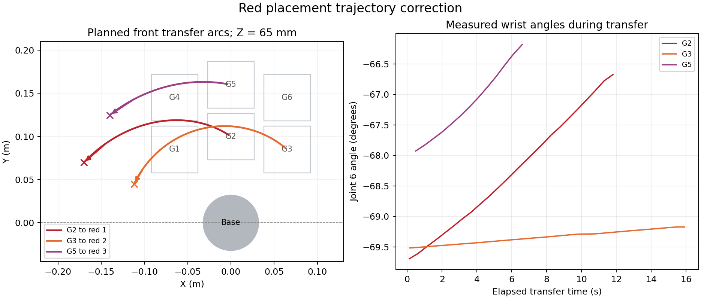

# 原场景仿真验收记录（2026-09-14历史版本）

本版本在固定点抓放基础上实现自动识别、六网格分类、长任务反馈、异常处理和独立验收，并调整红色归位路径。以下数据对应原红蓝方块场景；最新桥型仿真见相邻的experiment3_sim_bridge_20260921目录。

## 实测结果

- 正常场景：6 个物体，6 个分类正确，红蓝两类，状态 PASS；约 466.3 秒。
- 正常场景关节采样 37412 次，越限 0 次，非允许物理接触对 0 个。
- 异常场景：PASS；真实空格、真实绿色未知类已跳过，不可达与张爪故障注入均正确拒绝并恢复；正确分类 2 个。
- 结果由 Gazebo 实际最终位置和真实类别独立核验，不根据控制器的成功标志推算。

正常记录：[acceptance.json](../results/normal_front_arc_04/acceptance.json)，[实际录像](../results/normal_front_arc_04/simulation_demo.mp4)。
异常记录：[acceptance.json](../results/exceptions_front_arc_03/acceptance.json)，[实际录像](../results/exceptions_front_arc_03/simulation_demo.mp4)。

## 红色归位路径

先垂直抬升，保持物体中心 Z=65 mm，沿前方短圆弧移动，随后垂直放下。腕部保持同一逆解分支，接近和回零均采用经碰撞检查的单调关节插值。

| 已执行任务 | 计划方位变化 | 计划最大相邻关节变化 | 实测落点误差 |
|---|---:|---:|---:|
| G2 → 红区 1 | 67.62° | 3.76° | 0.297 mm |
| G3 → 红区 2 | 105.52° | 1.43° | 0.134 mm |
| G5 → 红区 3 | 48.24° | 3.19° | 0.273 mm |

实际关节采样范围、计划点和测量来源见 [trajectory_verification.json](../results/normal_front_arc_04/trajectory_verification.json)。上述方位和相邻变化是计划值，落点误差为 Gazebo 测量值；没有将计划轨迹冒充实测末端轨迹。

## 逐项核查

| 第一阶段要求 | 实现与证据 | 结论 |
|---|---|---|
| 机械臂、夹爪、俯视相机、固定网格、至少两类 | URDF、generate_world.py、sorting.yaml；六个网格、红蓝两类 | 已实现并运行 |
| Image 与 Detection2DArray，类别、框、置信度 | detector.py；真实 Gazebo 图像，HSV 颜色模型，detections.jsonl | 已实现并运行 |
| 框中心→固定网格→类别分类区 | common.py、task_controller.py；不读取类别真值 | 已实现并运行 |
| 抓取→分类→回零→自动循环 | task3_motion.py；逐物体 motion_events.jsonl | 已实现并运行 |
| 可反馈长时间任务接口 | grasp_bridge.py；唯一任务号、忙碌拒绝、心跳、结果、取消、超时 | 已实现并运行 |
| 行为树或状态机 | task_controller.py、sorting.yaml；task_states.jsonl | 已实现并运行 |
| 空格、未知、不可达、抓取失败 | exceptions 场景；后两者为显式故障注入 | 已验证 |
| 一条 launch 启动、至少六物体五成功、至少两类 | 02_run_demo.sh；正常独立验收记录 | 已通过 |
| 无明显碰撞或关节越限 | MoveIt 沿途检查、实际关节监测、Gazebo 接触监测 | 本次运行未检出 |
| 源码、依赖、模型/类别/网格/状态机配置、日志、视频、报告 | src、install_dependencies.sh、config、results、本文 | 仿真材料已补齐 |

## 与后续实机测试的关系

本记录仅描述原场景仿真。实机六轮验收及原始日志已单独收录于 [实机材料](../../../04_Evidence/) 和 [结果索引](../../../05_Records/)。[历史阶段计划](真机待验证项.md)保留当时的验证安排，不作为当前未完成项清单。

本次默认检测器为 HSV；可选 YOLO 后端未计入本次验证。每个固定工位的方块朝向与对应夹爪取物姿态对齐，未实现任意朝向抓取。仿真抓取采用对位后约束附着，不证明真实摩擦抓取效果。65 mm 转运高度针对本场景 40 mm 方块，名义底部净空 5 mm；改变场景须重新验证。碰撞几何为模型近似，监测穿透阈值为 2 mm，关节容差为 0.015 rad。

本目录收录上述正常与异常两次验收记录。桥型版本的调试与最终复测记录单独保存在experiment3_sim_bridge_20260921目录。
